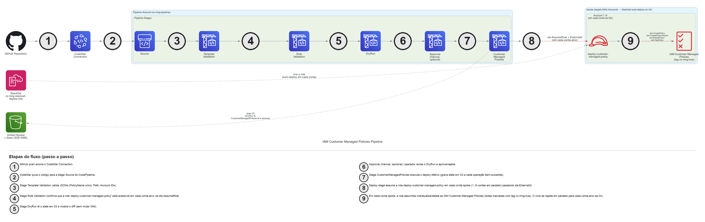
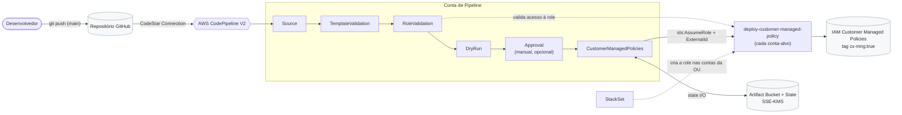
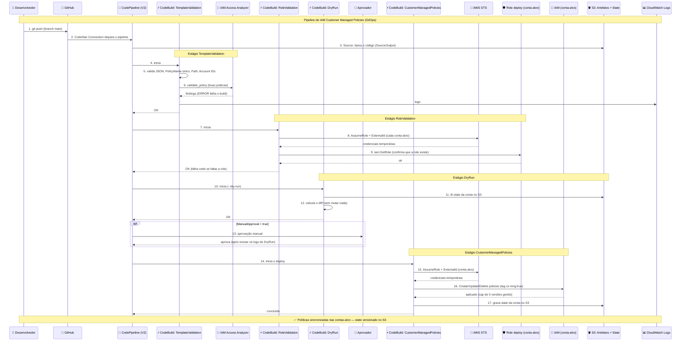

# IAM Customer Managed Policies Pipeline

Pipeline CI/CD para gerenciamento automatizado de IAM Customer Managed Policies em múltiplas contas AWS via CodePipeline.

## Diagrama de Arquitetura



> Fonte editável: [`images/architecture-diagram.drawio`](images/architecture-diagram.drawio).
> A imagem PNG é regerada via [`scripts/generate_architecture_diagram.py`](scripts/generate_architecture_diagram.py) (requer `graphviz` no sistema e `diagrams` no Python).



## Arquitetura AWS Detalhada

O diagrama de sequência abaixo detalha, passo a passo, as interações entre os serviços AWS ao longo dos estágios do pipeline — do `git push` do desenvolvedor até a criação/atualização das políticas nas contas-alvo, com o state versionado no S3.



## Pré-requisitos

### 1. GitHub Fine-Grained Personal Access Token (bootstrap token)

> ⚠️ **Escopo elevado = uso único.** O token descrito aqui é usado **apenas** pelo recurso `AWS::CodeStar::GitHubRepository` (ver `cfn/cx-mng-pipeline.yaml:148-160`) para **criar o repositório pela primeira vez**. Depois que o repositório existir, o token deve ser **revogado** (ou substituído por um token *downscoped* a `Contents: read` / `Metadata: read` somente neste repositório) e o secret do Secrets Manager atualizado — veja a seção [Pós-bootstrap: downscoping obrigatório do token](#pós-bootstrap-downscoping-obrigatório-do-token). A pipeline em estado estacionário autentica no GitHub via **CodeStar Connection** (`cfn/cx-mng-pipeline.yaml:741-742`), não por este PAT.

**Preferencial — GitHub App installation token:** sempre que possível, use um **GitHub App** instalado apenas em `${RepositoryOwner}/${RepositoryName}` e gere um *installation token* (vida máxima de 1 hora) como `GITHUB_TOKEN` para o bootstrap. Isso dá expiração nativa, restrição ao repositório único e trilha de auditoria por `installation_id`, evitando um PAT de conta de longa duração.

**Alternativa — Fine-Grained PAT (apenas se GitHub App não for viável):**

- Marque **Expiration** com o menor prazo possível (sugerido: ≤ 7 dias, apenas durante o bootstrap).
- **Resource owner:** `${RepositoryOwner}` (nunca a conta pessoal se o repo for de uma organização).
- **Repository access:** `Only select repositories` → selecione **apenas** `${RepositoryOwner}/${RepositoryName}` (ou, se o repo ainda não existir, use `All repositories` do owner e revogue o token logo após a criação).
- **Permissions estritamente limitadas ao que a API de criação exige:**
  - **Account permissions:** `Administration` → Read and write — **requerido apenas** para o endpoint que o CloudFormation chama para criar o repositório privado (`POST /user/repos` / `POST /orgs/{org}/repos`). Nenhum passo da pipeline em runtime usa esta permissão.
  - **Repository permissions:**
    - `Contents` → Read and write (necessário para o seed inicial a partir do S3)
    - `Metadata` → Read-only (obrigatório em todo fine-grained token)
    - `Issues` → Read and write (combina com `EnableIssues: true`)

**Não conceda** nenhuma outra permission (em particular: `Administration` em nível de *repositório* não é necessária e permitiria deletar o repo ou alterar branch protection / rulesets — mantê-la desmarcada é o que impede este token de desarmar os controles descritos em [Baseline de proteção da branch rastreada](#baseline-de-proteção-da-branch-rastreada)).

Acesse: GitHub → Settings → Developer settings → Personal access tokens → Fine-grained tokens → Generate new token

### 2. AWS Secrets Manager

Armazene o token do GitHub no Secrets Manager. Documente a data de expiração do token no `--description` para que a rotação não seja esquecida:

```bash
aws secretsmanager create-secret \
  --name dev/cx-mgn-pipe/github \
  --secret-string "<GITHUB_TOKEN>" \
  --description "Bootstrap token para AWS::CodeStar::GitHubRepository. Downscope/revogue após o primeiro deploy — ver README 'Pós-bootstrap'. Expira: <YYYY-MM-DD>" \
  --region us-east-1
```

Após o bootstrap, atualize este secret com o token *downscoped* (ou um placeholder revogado) usando `aws secretsmanager put-secret-value --secret-id dev/cx-mgn-pipe/github --secret-string "<NEW_SCOPED_TOKEN>"`. O recurso `CxMngGitHubRepository` resolve o valor pelo nome do secret via `{{resolve:secretsmanager:${SecretId}::::}}`, então a atualização propaga em qualquer `cloudformation update-stack` subsequente sem alterar o template.

#### Baseline de proteção da branch rastreada

Assim que o repositório existir, configure os seguintes controles no GitHub para que o token não seja o controle que os desabilita:

- **Branch protection / ruleset** em `${BranchName}` (default `main`):
  - `Require a pull request before merging` com `Require approvals ≥ 1` e `Dismiss stale approvals on new commits`.
  - `Require review from Code Owners`.
  - `Require status checks to pass before merging` (quando houver CI de pré-merge).
  - `Require signed commits` (recomendado).
  - `Restrict who can push to matching branches` — remover `Allow force pushes` e `Allow deletions`.
- **`CODEOWNERS`** na raiz do repositório cobrindo `cfn/`, `source/`, `templates/` com revisores humanos distintos do operador do pipeline.
- Documentar que **a conta/App que detém o token do bootstrap NÃO deve estar nos bypass actors** do ruleset.

Esse baseline é parte do modelo de confiança do pipeline (`Source action` em `cfn/cx-mng-pipeline.yaml:732-747` confia no que estiver na branch rastreada) e deve ser auditado periodicamente.

#### Pós-bootstrap: downscoping obrigatório do token

Depois que `CxMngGitHubRepository` tiver criado o repositório com sucesso (passo 6 da [Ordem de Deploy](#ordem-de-deploy)), execute **imediatamente** um dos caminhos abaixo:

1. **Revogar o token de bootstrap** (preferido quando `CxMngGitHubRepository` for removido do template no próximo update — veja a nota de desacoplamento abaixo).
2. **Substituir por token *downscoped*** (quando o recurso ainda é mantido no stack para gerenciamento declarativo): gere um novo fine-grained PAT (ou installation token do GitHub App) com **apenas**:
   - **Repository access:** `Only select repositories` → `${RepositoryOwner}/${RepositoryName}`.
   - **Repository permissions:** `Contents` → Read-only, `Metadata` → Read-only. **Nada** em `Account permissions`.
   - Atualize o secret: `aws secretsmanager put-secret-value --secret-id dev/cx-mgn-pipe/github --secret-string "<DOWNSCOPED_TOKEN>"`.
   - Revogue o token original no GitHub.

**Rotação recorrente:** rotacione o secret conforme a política da conta (sugerido: ≤ 90 dias para PAT, ≤ 1 hora via GitHub App). Em cada rotação, atualize `dev/cx-mgn-pipe/github` com `put-secret-value` **antes** de revogar o token antigo, para evitar janela em que um `cloudformation update-stack` resolva um secret inválido.

**Desacoplamento recomendado (opcional, uma vez por ambiente):** após o repositório estar criado e com branch protection configurada, remova o recurso `CxMngGitHubRepository` do template e aplique um `cloudformation update-stack` com `UsePreviousValue=true` nos demais parâmetros. Isso elimina a dependência do stack em `RepositoryAccessToken` / `SecretId` por completo e permite revogar o PAT sem precisar manter um token válido no secret. O repositório continua rastreado pelo pipeline via CodeStar Connection, que não usa este token.

### 3. S3 Bucket com código inicial

Crie um bucket S3 e faça upload do arquivo `.zip` com o código que ficará no repositório:

```bash
# Criar o bucket
aws s3 mb s3://iam-cx-mng-pipeline-initialcode --region us-east-1

# A partir da raiz do projeto, gerar o zip excluindo arquivos que NÃO devem ir para o repo:
cd iam-cx-mng-pipeline-main
zip -r iam-cx-mng-pipeline.zip . \
  -x ".git/*" \
  -x ".venv/*" \
  -x ".pytest_cache/*" \
  -x "**/__pycache__/*" \
  -x "cfn/*" \
  -x "scripts/*" \
  -x "tests/*" \
  -x "images/*" \
  -x "README.md" \
  -x "tests/README.md" \
  -x "requirements-dev.txt" \
  -x "pytest.ini"

# Upload do zip
aws s3 cp iam-cx-mng-pipeline.zip s3://iam-cx-mng-pipeline-initialcode/
```

O `.zip` carrega no GitHub apenas o código que a pipeline precisa em runtime — os arquivos de IaC (`cfn/`), testes (`tests/`), scripts auxiliares (`scripts/`) e o README continuam no repositório de origem mas **não** são publicados pelo `AWS::CodeStar::GitHubRepository`.

Estrutura esperada do `.zip`:

```
iam-cx-mng-pipeline.zip
├── source/
│   ├── validation/
│   │   ├── customer-managed-validation.py
│   │   └── role-validation.py
│   └── customer-managed-policies/
│       └── customer-managed-deploy.py
├── templates/
│   ├── assignments/
│   │   └── assignments.json
│   └── customer-managed-policies/
│       ├── My1CustomerPolicy.json
│       └── ...
├── requirements.txt
├── LICENSE
└── .gitignore
```

### 4. StackSet para IAM Role nas contas de destino

Deploy do StackSet com o template `cfn/cx-mng-stackset-deploy-role.yaml` na OU raiz com auto-deploy habilitado:

```bash
aws cloudformation create-stack-set \
  --stack-set-name cx-mng-deploy-role \
  --template-body file://cfn/cx-mng-stackset-deploy-role.yaml \
  --parameters ParameterKey=PipelineAccountId,ParameterValue=<PIPELINE_ACCOUNT_ID> \
               ParameterKey=NamingConvention,ParameterValue=cx-mng-pipeline \
               ParameterKey=ExternalId,ParameterValue=<EXTERNAL_ID_VALUE> \
  --permission-model SERVICE_MANAGED \
  --auto-deployment Enabled=true,RetainStacksOnAccountRemoval=false \
  --capabilities CAPABILITY_NAMED_IAM \
  --region us-east-1
```

Isso cria a role `deploy-customer-managed-policy` em todas as contas da OU automaticamente, com a `Condition: sts:ExternalId` exigindo o valor passado.

### 5. GitHub Default Branch

Configure o Git para usar `main` como branch padrão:

```bash
git config --global init.defaultBranch main
```

### 6. Gerar `ExternalId` para cross-account

A pipeline usa `sts:ExternalId` como shared secret em toda chamada `AssumeRole` cross-account (proteção contra confused deputy). Gere um valor forte uma única vez e use o **mesmo valor** nos 2 stacks (pipeline + StackSet):

```bash
# Gerar valor seguro (alfanumérico + hífen, 64 chars)
openssl rand -hex 32
# exemplo de saída: 7b3e5f2a1c8d4e9f0a6b3c5d7e9f2a1b4c6d8e0f2a4b6c8d0e2f4a6b8c0d2e4f
```

Guarde esse valor — você vai passá-lo como parâmetro `ExternalId` em **ambos** os comandos de deploy abaixo. Para rotação no futuro, atualize a pipeline primeiro com o novo valor, depois o StackSet (a ordem inversa bloqueia a pipeline).

## Deploy da Pipeline

### Parâmetros do CloudFormation (`cx-mng-pipeline.yaml`)

Todos os parâmetros têm validação de input (`AllowedPattern`, `MinLength`, `MaxLength`, `ConstraintDescription`) — entradas inválidas falham na criação do stack com mensagem clara, antes de criar qualquer recurso.

| Parâmetro | Descrição | Default | Validação |
|-----------|-----------|---------|-----------|
| `RepositoryType` | Tipo do repositório (GitHub ou GitLab) | `GitHub` | `AllowedValues: [GitHub, GitLab]` |
| `S3BucketCodeBucket` | Bucket S3 com o código inicial (.zip) | `iam-cx-mng-pipeline-initialcode` | regex S3 bucket name (3-63 chars) |
| `S3BucketCodeKey` | Nome do arquivo .zip no bucket S3 | `iam-cx-mng-pipeline.zip` | deve terminar em `.zip`, max 1024 chars |
| `RepositoryName` | Nome do repositório GitHub | `iam-cx-mng-pipeline` | regex GitHub repo name (max 100 chars) |
| `RepositoryOwner` | Username do owner do repositório GitHub | `dennisasilva` | regex GitHub username (max 39 chars) |
| `BranchName` | Branch do repositório que a pipeline rastreia | `main` | regex git branch name (max 250 chars) |
| `SecretId` | Nome do secret no Secrets Manager com o token GitHub | `dev/cx-mgn-pipe/github` | regex secret name + `NoEcho: true` |
| `ExternalId` | Shared secret usado em todo `sts:AssumeRole` cross-account. Mesmo valor passado nos 2 stacks (pipeline + StackSet). | _(sem default — obrigatório)_ | 16-64 chars `[A-Za-z0-9_-]`, `NoEcho: true` |
| `NamingConvention` | Prefixo para nomes dos recursos | `cx-mng-pipeline` | lowercase, max 30 chars (limita IAM RoleName a 64 chars) |
| `ManualApproval` | Habilitar stage de aprovação manual | `true` | `AllowedValues: ['true', 'false']` |

### Comando de deploy

```bash
aws cloudformation deploy \
  --template-file cfn/cx-mng-pipeline.yaml \
  --stack-name cx-mng-policies-pipeline \
  --capabilities CAPABILITY_NAMED_IAM \
  --parameter-overrides \
    RepositoryType=GitHub \
    S3BucketCodeBucket=iam-cx-mng-pipeline-initialcode \
    S3BucketCodeKey=iam-cx-mng-pipeline.zip \
    RepositoryName=iam-cx-mng-pipeline \
    RepositoryOwner=dennisasilva \
    BranchName=main \
    SecretId=dev/cx-mgn-pipe/github \
    ExternalId=<EXTERNAL_ID_VALUE> \
    NamingConvention=cx-mng-pipeline \
    ManualApproval=true \
  --region us-east-1
```

> **Importante:** Use o **mesmo `ExternalId`** que você passou no StackSet do passo 4 dos pré-requisitos.

> **Importante:** Após o deploy, acesse o console do CodeStar Connections e complete a conexão com o GitHub (status deve mudar de `PENDING` para `AVAILABLE`).

### Validação pós-deploy

Após o `cloudformation deploy`, rode o **smoke test** para confirmar que o stack ficou em estado saudável. Detalhes completos do script, output esperado e como integrá-lo em scripts de release: ver seção [Smoke test pós-deploy](#smoke-test-pós-deploy) mais abaixo.

```bash
python3 scripts/post_deploy_smoke_test.py \
  --stack-name cx-mng-policies-pipeline \
  --naming-convention cx-mng-pipeline \
  --region us-east-1
```

## Deploy via Terraform (alternativa ao CloudFormation)

O diretório [`terraform/`](terraform/) contém uma variante da pipeline equivalente ao `cfn/cx-mng-pipeline.yaml`, com a **mesma arquitetura** (6 estágios, bucket endurecido, roles com KMS/`kms:ViaService`, `sts:ExternalId` no cross-account). Use **ou** CloudFormation **ou** Terraform — não os dois ao mesmo tempo na mesma conta (os nomes de recursos colidem).

### Diferenças em relação ao CloudFormation

- **Repositório de origem:** o CFN cria o repositório via `AWS::CodeStar::GitHubRepository` (bootstrap a partir de um `.zip` no S3, usando o `SecretId`). Esse recurso é específico do CloudFormation e **não tem equivalente no Terraform**. A variante Terraform assume que o **repositório já existe** e apenas conecta a pipeline a ele — por isso não há `S3BucketCodeBucket`/`S3BucketCodeKey`/`SecretId` nas variáveis.
- **Role cross-account:** o CFN usa **StackSet** (`SERVICE_MANAGED`) para criar a role em toda uma OU de uma vez. Terraform não tem StackSet; o módulo [`terraform/deploy-role/`](terraform/deploy-role/) cria a mesma role, mas deve ser aplicado **uma vez por conta-alvo**. Para organizações inteiras, o StackSet do CloudFormation continua sendo o caminho mais simples.

### Deploy

```bash
cd terraform

# 1) Configurar variáveis
cp terraform.tfvars.example terraform.tfvars
# edite terraform.tfvars e defina o external_id (openssl rand -hex 32)

# 2) Inicializar e revisar o plano
terraform init
terraform plan

# 3) Aplicar
terraform apply
```

Depois, crie a role nas contas-alvo (uma vez por conta), usando o **mesmo `external_id`**:

```bash
cd terraform/deploy-role
terraform init
terraform apply \
  -var="pipeline_account_id=<ID_DA_CONTA_DO_PIPELINE>" \
  -var="external_id=<MESMO_EXTERNAL_ID>"
```

> Assim como no CloudFormation, após o `apply` a **CodeStar Connection** nasce `PENDING` — conclua o handshake no console (Developer Tools → Connections) para `AVAILABLE` antes do primeiro run.

> **Estado do Terraform:** este módulo usa backend local por padrão. Para uso em equipe, configure um backend remoto (ex.: S3 + DynamoDB lock). Lembre-se de que `external_id` é sensível e fica registrado no state — proteja o backend adequadamente.

## Estrutura do Projeto

```
.
├── cfn/
│   ├── cx-mng-pipeline.yaml              # Template principal da pipeline (CloudFormation)
│   └── cx-mng-stackset-deploy-role.yaml  # StackSet para role nas contas de destino
├── terraform/                            # Variante Terraform da pipeline (alternativa ao cfn/)
│   ├── versions.tf                       # Terraform + provider AWS (~> 5.40)
│   ├── variables.tf                      # Variáveis (espelham os Parameters do CFN)
│   ├── data.tf                           # Data sources + locals
│   ├── codestar.tf                       # Conexão CodeStar (GitHub/GitLab)
│   ├── s3.tf                             # Bucket de artefatos + lifecycle + policy
│   ├── iam.tf                            # 4 roles (CodeBuild x3 + CodePipeline)
│   ├── codebuild.tf                      # 4 projetos CodeBuild + buildspecs
│   ├── codepipeline.tf                   # Pipeline V2 (Approval via dynamic block)
│   ├── outputs.tf                        # Outputs (pipeline, bucket, conexão)
│   ├── terraform.tfvars.example          # Exemplo de variáveis
│   └── deploy-role/                      # Role cross-account por conta (equivalente ao StackSet)
│       └── main.tf
├── source/                               # Código que vai para o repositório GitHub
│   ├── validation/
│   │   ├── customer-managed-validation.py
│   │   └── role-validation.py
│   └── customer-managed-policies/
│       └── customer-managed-deploy.py
├── templates/                            # JSONs declarativos (vão para o repositório)
│   ├── assignments/
│   │   └── assignments.json              # Mapeamento policy → contas
│   └── customer-managed-policies/
│       ├── My1CustomerPolicy.json
│       └── ...
├── tests/                                # Suite pytest (120 testes)
│   ├── README.md                         # Documentação detalhada da suite
│   ├── conftest.py
│   ├── test_customer_managed_validation.py
│   ├── test_role_validation.py
│   ├── test_customer_managed_deploy.py
│   ├── test_stackset_role_template.py    # Valida o template da role cross-account
│   └── test_pipeline_bucket_policy.py    # Valida a bucket policy da pipeline
├── scripts/
│   ├── post_deploy_smoke_test.py         # Validação pós-deploy (AWS real)
│   └── generate_architecture_diagram.py  # Regenera o diagrama de arquitetura
├── images/
│   └── architecture-diagram.drawio
├── .gitignore
├── LICENSE
├── README.md
├── pytest.ini
├── requirements.txt                      # boto3 (runtime)
└── requirements-dev.txt                  # pytest + moto (dev)
```

## Pipeline Stages

### 1. Source
Puxa o código do GitHub via CodeStar Connection. Trigger automático em push na branch configurada via parâmetro `BranchName` (default: `main`).

### 2. TemplateValidation
Roda `customer-managed-validation.py`. Valida:
- **Sintaxe JSON** de cada arquivo em `templates/customer-managed-policies/` e `templates/assignments/`
- **Unicidade do `PolicyName`** entre policies (sem duplicatas)
- **Formato do `Path`** de cada policy (regex `^/(?:[A-Za-z0-9._=+-]+/)*$`, max 512 chars) — pega `//`, paths sem `/` no início/fim, chars proibidos
- **Formato dos Account IDs** em `Target` (regex `^\d{12}$`) — pega typos do tipo trailing whitespace, formatação de planilha (vírgulas, traços), tipo errado (int em vez de string)

Falha cedo, antes de qualquer call AWS, com mensagem indicando arquivo + SID + valor problemático.

### 3. RoleValidation
Roda `role-validation.py`. Para cada conta listada em qualquer `Target` dos assignments, faz `sts:AssumeRole` na role `deploy-customer-managed-policy` e chama `iam:GetRole` para confirmar que ela existe e está acessível. Falha **antes** de qualquer mudança se alguma conta não tiver a role configurada (StackSet ausente, role removida, etc.).

### 4. DryRun
Roda `customer-managed-deploy.py --dry-run`:
- Compara o state salvo no S3 com o estado atual das policies nas contas
- Loga diff detalhado das ações adicionadas/removidas e dos resources alterados
- Detecta drift (alterações manuais em policies gerenciadas pela pipeline)
- **Não faz nenhuma mutação** — apenas reporta o que faria

### 5. Approval (opcional)
Stage de aprovação manual. O operador revisa os logs do DryRun no CodeBuild e aprova ou rejeita. Controlado pelo parâmetro `ManualApproval`.

### 6. CustomerManagedPolicies
Roda `customer-managed-deploy.py` (sem `--dry-run`):
- **Cria** policies novas com tag `cx-mng:true` automaticamente aplicada
- **Atualiza** policies existentes (apenas as que têm tag `cx-mng:true`) — cria nova IAM policy version e gerencia o cap de 5 versões deletando a mais antiga quando necessário
- **Deleta** policies removidas dos assignments (apenas as que têm tag `cx-mng:true`)
- **Pula** policies que já estão na conta mas **não** têm a tag `cx-mng:true` (safety check — não toca em policies criadas por humanos ou outros pipelines)
- Salva state no S3 após cada operação bem-sucedida

Cada `assume_role` cross-account usa um `RoleSessionName` único que inclui o `CODEBUILD_BUILD_ID` (ex: `CxMngDeploy-cx-mng-pipeline-abc12345-...`) para rastreabilidade no CloudTrail das contas-alvo.

## Gestão de Estado (S3)

O state é armazenado no bucket de artefatos da pipeline em `state/<account-id>.json`:

```json
{
  "account_id": "111111111111",
  "last_execution": "2026-04-12T16:00:00+00:00",
  "policies": {
    "My1CustomerPolicy": {
      "arn": "arn:aws:iam::111111111111:policy/My1CustomerPolicy",
      "version_id": "v4",
      "policy_hash": "sha256:abc123...",
      "last_deployed": "2026-04-12T16:00:00+00:00"
    }
  }
}
```

O state permite:
- Pular policies cujo hash do documento **não mudou** desde o último deploy (evita criar versões IAM desnecessárias)
- Detectar **drift** comparando hash salvo vs documento atual no IAM
- Rastrear quais contas foram gerenciadas no passado para limpeza quando saem dos assignments
- Histórico de deploys (versão atual nunca expira; versões antigas mantidas por 365 dias — ver "Decisões de Segurança")

## Assignments

Arquivo JSON em `templates/assignments/` que associa policies a contas:

```json
{
  "Assignments": [
    {
      "SID": "MyFirstPolicy",
      "Target": ["111111111111", "222222222222"],
      "CustomerManagedPolicyName": ["My1CustomerPolicy", "My2CustomerPolicy"]
    }
  ]
}
```

**Regras importantes:**
- Cada `Target` deve ser exatamente 12 dígitos (a stage TemplateValidation rejeita o resto).
- O `CustomerManagedPolicyName` referencia o `PolicyName` do JSON da policy — o **nome do arquivo não é usado**, só o `PolicyName` interno.

## Customer Managed Policies

Arquivo JSON em `templates/customer-managed-policies/` com a definição da policy:

```json
{
  "PolicyName": "My1CustomerPolicy",
  "Description": "Description of the policy",
  "Path": "/",
  "PolicyDocument": {
    "Version": "2012-10-17",
    "Statement": [
      {
        "Sid": "CustomPolicy",
        "Action": ["ec2:Describe*"],
        "Effect": "Allow",
        "Resource": "*"
      }
    ]
  },
  "Tags": []
}
```

**Convenções:**
- `PolicyName` deve ser igual ao **nome do arquivo** sem `.json` (a stage TemplateValidation valida unicidade entre os PolicyNames).
- `Path` deve começar e terminar com `/`. Padrão é `/`.
- `Tags` declaradas aqui são aplicadas além da tag obrigatória `cx-mng:true` que a pipeline adiciona em toda policy criada.

## Suite de testes

A pipeline tem **120 testes** pytest. A suite roda em **~5 segundos** local, sem precisar de credenciais AWS — toda integração com AWS é mockada via [`moto`](https://github.com/getmoto/moto).

### Setup (uma vez)

```bash
cd cloudformation/iam-cx-mng-pipeline-main
python3 -m venv .venv
source .venv/bin/activate
pip install -r requirements-dev.txt
```

### Distribuição por arquivo

| Arquivo | Testes | O que cobre |
|---|---|---|
| `test_customer_managed_deploy.py` | 54 | Orquestração create/update/delete, `policy_hash`, S3 state round-trip, IAM cross-account (moto), cap de 5 versões IAM, ExternalId, dry-run |
| `test_customer_managed_validation.py` | 46 | Sintaxe JSON, unicidade de `PolicyName`, regex de `Path`, Account IDs, smoke contra os templates reais |
| `test_role_validation.py` | 13 | Descoberta de contas-alvo, assume-role cross-account, `RoleSessionName`, uso do ExternalId |
| `test_stackset_role_template.py` | 4 | Assertivas sobre o template CFN da role cross-account (trust, condições, tags) |
| `test_pipeline_bucket_policy.py` | 3 | Assertivas sobre a bucket policy (HTTPS-only, restrição de escrita em `state/`) |
| **Total** | **120** | Rodam em ~5s, sem credenciais AWS |

A suite mistura testes unitários puros, integração de filesystem (lê os JSONs reais em `templates/`) e orquestração AWS mockada via `moto`. Os testes cujo nome começa com `test_real_` são a "primeira linha de defesa" contra JSONs de produção inconsistentes.

### Comandos por caso de uso

```bash
# Suite inteira (use antes de cada PR)
pytest

# Versão silenciosa (ideal para CI — só dots)
pytest -q

# Versão verbosa (mostra cada nome de teste)
pytest -v

# Ver os testes mais lentos (otimização)
pytest --durations=10

# ─── Por arquivo ─────────────────────────────────────────────
pytest tests/test_customer_managed_validation.py    # validador
pytest tests/test_customer_managed_deploy.py        # deploy
pytest tests/test_role_validation.py                # role validator

# ─── Por padrão (substring no nome do teste) ─────────────────
pytest -k policy_hash                               # só policy hash
pytest -k "validate_account_id and rejects"         # casos negativos
pytest -k external_id                               # só ExternalId
pytest -k policy_paths                              # só validação de Path

# ─── Por categoria ───────────────────────────────────────────
pytest -k real_                                     # smoke contra templates reais
pytest -k "create_update or delete_"                # orquestração (moto)
pytest -k "policy_hash or filter_tags or build_session_name" # pure unit puros
```

### Output esperado

**Sucesso (a saída que você quer ver antes de merge):**

```
$ pytest -q
.........................................................................
.........................................................................
[100%]
120 passed in 4.79s
```

**Falha (exemplo: alguém quebrou a regex de Path):**

```
$ pytest -q
.....F.....................................................
================================== FAILURES ==================================
__________ test_validate_policy_paths_rejects_invalid_paths[//-...] __________
...
ValueError was not raised
=========================== 1 failed, 119 passed ============================
```

A linha `_______ test_NOME _______` aponta exatamente o que quebrou. Use `pytest -v` para ver mais contexto.

### Smoke tests contra os templates reais (a "primeira linha de defesa")

Os 3 testes que começam com `test_real_` validam os JSONs **de produção** dentro de `templates/`. Eles falham se alguém commitar:
- Uma policy com `PolicyName` duplicado
- Uma policy com `Path` inválido
- Um `Target` em `assignments.json` que não é um Account ID válido

Rode antes de qualquer commit que mexa em `templates/`:

```bash
pytest -k real_ -v
```

Esperado:
```
tests/test_customer_managed_validation.py::test_real_templates_have_valid_paths PASSED
tests/test_customer_managed_validation.py::test_real_assignments_have_valid_target_ids PASSED
tests/test_customer_managed_validation.py::test_real_templates_have_unique_policy_names PASSED
3 passed, 110 deselected in 0.67s
```

Se algum desses falhar: **não faça merge** até corrigir o JSON.

### Demo: ver um teste detectando um bug

Para entender como os testes pegam regressões, você pode introduzir um erro de propósito e ver o teste falhar:

```bash
# 1. Backup do JSON real
cp templates/customer-managed-policies/My1CustomerPolicy.json /tmp/backup.json

# 2. Quebrar o Path para um valor inválido
sed -i '' 's/"Path": "\/"/"Path": "\/\/"/' templates/customer-managed-policies/My1CustomerPolicy.json

# 3. Rodar o smoke — vai falhar com mensagem clara
pytest tests/test_customer_managed_validation.py::test_real_templates_have_valid_paths -v
# Esperado: FAIL com "invalid Path '//' (must start and end with '/'...)"

# 4. Restaurar
cp /tmp/backup.json templates/customer-managed-policies/My1CustomerPolicy.json

# 5. Confirmar que voltou ao normal
pytest tests/test_customer_managed_validation.py::test_real_templates_have_valid_paths -v
# Esperado: PASSED
```

### Documentação detalhada

Para entender cada um dos 120 testes, taxonomia (unit/integration/E2E) e limitações de cobertura honestas (o que `moto` não simula vs AWS real): **[`tests/README.md`](tests/README.md)**.

### Quando rodar o quê

| Você está... | Comando |
|---|---|
| Mexendo em código Python (`source/*.py`) | `pytest` |
| Mexendo em template CFN (`cfn/*.yaml`) | `cfn-lint cfn/*.yaml` + revisar diff |
| Mexendo no Terraform (`terraform/**.tf`) | `terraform fmt` + `terraform validate` |
| Mexendo nos templates JSON (`templates/`) | `pytest -k real_` (smoke) |
| Abrindo um PR | `pytest -q` + `cfn-lint cfn/*.yaml` |
| Aplicando deploy em produção | Suite + `cfn-lint` + change-set review + smoke pós-deploy |
| **Acabou de fazer `cloudformation deploy`** | **`scripts/post_deploy_smoke_test.py`** (ver próxima seção) |

## Smoke test pós-deploy

O script `scripts/post_deploy_smoke_test.py` valida **um deploy real** em AWS. Diferente do `pytest` (que valida lógica do código localmente, sem credenciais), o smoke test conecta na conta AWS e verifica recursos efetivamente criados.

### Quando usar

- Imediatamente depois de `aws cloudformation deploy`
- Como sanity check antes de operações críticas

### Comando

```bash
python3 scripts/post_deploy_smoke_test.py \
  --stack-name cx-mng-policies-pipeline \
  --naming-convention cx-mng-pipeline \
  --region us-east-1
```

Requer credenciais AWS válidas (via `aws configure`, SSO, ou variáveis de ambiente) com permissão de read-only nos recursos do stack.

### O que ele valida (13 checks)

| # | Check | O que verifica |
|---|---|---|
| 1 | Stack health | Status `CREATE_COMPLETE` ou `UPDATE_COMPLETE` |
| 2-5 | IAM roles | 4 roles esperados (`<NamingConvention>-{role-validation,template-validation,customer-managed-policies,code-pipeline}`) |
| 6 | CodePipeline | Pipeline `<NamingConvention>-pipeline` existe |
| 7-10 | CodeBuild projects | 4 projects esperados |
| 11 | S3 encryption | Bucket usa `aws:kms` |
| 12 | S3 public access | 4 flags `BlockPublicAccess` ativados |
| 13 | S3 versioning | Status `Enabled` |
| info | CodeStar Connection | Estado `AVAILABLE` ou `PENDING` (warn em PENDING) |

### Output esperado

Cada check imprime:
- **Checking**: o que está sendo verificado (recurso + propriedade concretos)
- **Why**: por que esse check importa (segurança ou operação)
- **Failure**: onde investigar se falhar
- **Result**: ✅ PASS ou ❌ FAIL

Exemplo de saída de uma execução bem-sucedida:

```
========================================================================
  Post-deploy smoke test for iam-cx-mng-pipeline
  Stack:              cx-mng-policies-pipeline (us-east-1)
  Naming convention:  cx-mng-pipeline
  Artifact bucket:    111111111111-us-east-1-cx-mng-artfcs
========================================================================

This script validates that a recently-deployed CloudFormation stack is
healthy and that the resources the pipeline depends on were created
correctly. It only READS — no AWS state is modified.

------------------------------------------------------------------------
[1/13] CloudFormation stack health
------------------------------------------------------------------------

  ▸ Checking : Stack 'cx-mng-policies-pipeline' reports a healthy *_COMPLETE status
    Why      : A stack in ROLLBACK_FAILED or UPDATE_ROLLBACK_FAILED means
               CloudFormation couldn't apply the template. Resources are in
               an inconsistent state and the pipeline cannot run.
    Failure  : AWS Console > CloudFormation > <stack> > Events tab.
               The first ERROR row shows the root cause.
               Reported status: UPDATE_COMPLETE
    Result   : ✅ PASS - Stack 'cx-mng-policies-pipeline' is in a healthy state

[... outros checks ...]

========================================================================
  Summary
========================================================================
  13/13 checks passed.

  Smoke test PASSED — the stack is operationally healthy.

  Next steps:
    * If the CodeStar Connection is PENDING, complete the OAuth
      handshake in the AWS console before pushing to GitHub.
    * Push a commit to the configured branch (BranchName parameter)
      to trigger the first pipeline run end-to-end.
    * Watch the CodePipeline console for stage progression.
```

### Códigos de saída

| Exit code | Significado |
|---|---|
| `0` | Todos os checks passaram |
| `1` | Pelo menos 1 check falhou — revisar logs |
| `2` | Erro do script (credenciais AWS ausentes, parâmetros inválidos) |

Use o exit code para integrar em scripts de deploy:

```bash
aws cloudformation deploy ... && \
  python3 scripts/post_deploy_smoke_test.py --stack-name ... \
                                            --naming-convention ... && \
  echo "✅ Deploy + smoke test OK" || echo "❌ Falha no deploy ou no smoke"
```

## Ordem de Deploy

1. Criar secret no Secrets Manager com o token GitHub de **bootstrap** (escopo mínimo descrito na seção 1 de Pré-requisitos; expiração curta — preferir GitHub App installation token)
2. Criar bucket S3 e fazer upload do `.zip` com código inicial
3. Deploy do StackSet `cx-mng-stackset-deploy-role.yaml` na OU raiz
4. Deploy do stack `cx-mng-pipeline.yaml` na conta da pipeline
5. **Rodar `scripts/post_deploy_smoke_test.py`** para confirmar que o stack está saudável
6. Completar a conexão CodeStar no console AWS
7. Renomear branch `master` para `main` no repositório GitHub (se necessário)
8. **Configurar branch protection / ruleset e `CODEOWNERS`** em `${BranchName}` conforme [Baseline de proteção da branch rastreada](#baseline-de-proteção-da-branch-rastreada) — a pipeline confia no conteúdo da branch, então este é o controle que o token de bootstrap NÃO pode poder desabilitar
9. **Downscoping/revogação do token de bootstrap**: substituir o valor em `dev/cx-mgn-pipe/github` por um token com apenas `Contents: read` / `Metadata: read` (ou, se `CxMngGitHubRepository` for removido do template, revogar o PAT por completo). Ver [Pós-bootstrap: downscoping obrigatório do token](#pós-bootstrap-downscoping-obrigatório-do-token)
10. Agendar rotação periódica do secret (`dev/cx-mgn-pipe/github`) conforme a política da conta — atualizar o secret **antes** de revogar o token antigo

## Decisões de Segurança

### Controles aplicados nos roles IAM

- **Princípio do menor privilégio em S3**: os 3 roles de CodeBuild (`role-validation`, `template-validation`, `customer-managed-policies`) e o `code-pipeline` role têm `s3:GetObject/PutObject/ListBucket` escopados a `${CxMgrartifactsBucket}` apenas — não podem tocar em qualquer bucket da conta.
- **KMS escopado por serviço**: `kms:Decrypt`/`kms:GenerateDataKey` nos 4 roles têm `Condition: kms:ViaService = s3.${region}.amazonaws.com`, restringindo o uso da KMS key à interação com S3 daquela região.
- **AssumeRole cross-account específico**: o `code-pipeline` role só pode `sts:AssumeRole` em `arn:aws:iam::*:role/deploy-customer-managed-policy`, não em roles arbitrários.
- **`sts:ExternalId` exigido em todo cross-account**: a role `deploy-customer-managed-policy` em cada conta-alvo tem `Condition: sts:ExternalId: <valor>`. Mesmo se a conta da pipeline for comprometida, um atacante que detenha apenas o ARN da role precisa também conhecer o valor do `ExternalId` (NoEcho parameter, não exposto no console). Pipeline e StackSet usam o **mesmo valor** — passado via parâmetro NoEcho em ambos os stacks. Nos scripts, lido da env var `EXTERNAL_ID` (injetada pelos CodeBuild projects via `EnvironmentVariables`).
- **Ações IAM destrutivas restritas por tag**: na role cross-account `deploy-customer-managed-policy`, as ações `iam:DeletePolicy`, `iam:DeletePolicyVersion`, `iam:CreatePolicyVersion`, `iam:TagPolicy` e `iam:UntagPolicy` só são permitidas em policies que já carregam a tag `cx-mng:true` (`Condition: aws:ResourceTag/cx-mng=true`). Isso torna o **IAM** (não apenas o script de deploy) o ponto de enforcement: mesmo um script com bug ou adulterado não consegue deletar/modificar policies que a pipeline não criou. `iam:CreatePolicy` fica num statement separado sem a condition (a policy ainda não tem tag no momento de criar; o script aplica `cx-mng:true` logo em seguida).
- **Sem dependências mortas**: nenhum dos roles tem `codecommit:GitPull` (a pipeline usa GitHub via CodeStar, não CodeCommit).

### Resiliência operacional dos scripts

- **Timeouts agressivos** em todos os clients boto3: `connect_timeout=10s`, `read_timeout=30s`. Conta inacessível falha em ~30s em vez de pendurar por minutos.
- **Retries com backoff adaptativo**: `max_attempts=2, mode='adaptive'` absorve throttling transiente sem amplificar problemas.
- **`RoleSessionName` único por execução**: cada `assume_role` carrega o `CODEBUILD_BUILD_ID` sanitizado, dando rastreabilidade no CloudTrail das contas-alvo.

### Criptografia do bucket de artefatos: AWS Managed KMS Key (`alias/aws/s3`)

O `CxMgrartifactsBucket` é criptografado com **SSE-KMS usando a chave gerenciada pela AWS** (`alias/aws/s3`), em vez de uma Customer Managed Key (CMK). Esta é uma decisão deliberada documentada também via `Metadata.SecurityDecisions.Encryption` no template.

**Trade-offs aceitos:**

| Capacidade | AWS Managed (`aws/s3`) | Customer Managed CMK |
|---|---|---|
| Custo mensal | Grátis | ~US$ 1/mês + uso |
| Audit por chave em CloudTrail | Sim | Sim (mais granular) |
| Revogabilidade instantânea | ❌ (chave é da conta) | ✅ |
| Política de chave customizável | ❌ (lockada) | ✅ |
| Cross-account key sharing | ❌ | ✅ |

**Justificativa:**
- O bucket guarda apenas artefatos da pipeline e arquivos de state (hash + ARN + timestamp). Não contém PII nem secrets.
- `BlockPublicAccess` total + `Deny` para tráfego não-HTTPS + `VersioningConfiguration: Enabled` já cobrem os controles de confidencialidade/integridade necessários.
- O custo de uma CMK custom (~US$ 1/mês + chamadas) e a operação para gerenciá-la não se justificam para esse workload.

**Quando trocar para Customer Managed CMK:**
- Requisito de compliance específico exigindo CMK.
- Necessidade de revogar acesso instantâneo (ex: incidente de segurança).
- Necessidade de auditoria/forense por chave individual.
- Cross-account key sharing.

Para fazer a troca, basta:
1. Criar um recurso `AWS::KMS::Key` com `EnableKeyRotation: true` e `KeyPolicy` permitindo os 4 roles da pipeline.
2. Trocar `BucketEncryption.ServerSideEncryptionByDefault.KMSMasterKeyID` para a alias da nova CMK.
3. Os 4 roles já têm `kms:Decrypt`/`kms:GenerateDataKey` com `kms:ViaService` condition — vão continuar funcionando contra qualquer key acessada via S3.

### Ownership do bucket: `BucketOwnerEnforced`

O bucket declara `OwnershipControls.Rules.ObjectOwnership: BucketOwnerEnforced`. Isso desabilita ACLs em nível de objeto: todo objeto escrito é automaticamente do bucket owner, e qualquer tentativa de aplicar ACL custom é rejeitada.

**Por que importa:**
- Centraliza controle de acesso na bucket policy + IAM (sem split-brain com ACLs).
- É o default para buckets novos desde abril/2023, mas declarar explicitamente garante que stacks recriados no futuro continuem com o mesmo comportamento, independente do default vigente.
- Compliance scanners (Prowler, Checkov, AWS Config) deixam de marcar o bucket como noncompliant.

### Retenção de artefatos no bucket

O bucket aplica regras de Lifecycle separadas por prefixo, garantindo que o `state/` (essencial para drift detection) nunca seja apagado pelo lifecycle dos artefatos da pipeline:

| Prefixo | Conteúdo | Retenção (versão atual) | Retenção (versões antigas) |
|---|---|---|---|
| `<NamingConvention>-pipeline/` | Artefatos do CodePipeline (SourceOutput zips, build outputs) | **90 dias** | 30 dias |
| `state/` | State files (`<account_id>.json` com hash + ARN + timestamp) | **Nunca expira** | 365 dias |
| Qualquer outro prefixo | (uploads manuais, se houver) | **Nunca expira** | — |

Ambas as regras também limpam multipart uploads incompletos após 7 dias.

**Por que dois prefixos disjoint:** S3 aplica todas as regras de lifecycle que casam com um objeto. Se a regra de expiração usasse `Prefix: ''` (catch-all), ela apagaria os state files também — mesmo que outra regra dissesse o contrário. Ao usar `Prefix: <pipeline-name>/` na regra de expiração e `Prefix: state/` na regra de preservação, os dois conjuntos nunca se sobrepõem por construção.

**Cenários relevantes:**
- **Troubleshooting de build antigo (até 90 dias)**: artefatos disponíveis em `s3://<bucket>/<pipeline-name>/SourceOutput/`.
- **Drift detection ininterrupta**: `state/<account>.json` da última execução sempre disponível.
- **Forense (até 365 dias)**: versões antigas de state files acessíveis via `aws s3api list-object-versions --bucket ... --prefix state/`.
- **Conta removida dos assignments**: o script `customer-managed-deploy.py` deleta o state daquela conta na primeira execução pós-remoção (lógica explícita, não depende do lifecycle).

### Integridade do state (prefixo `state/`)

O `customer-managed-deploy.py` confia no `state/<account>.json` para decidir se pula uma policy (hash match) e para detectar drift. Para impedir que esse arquivo seja adulterado e usado para "congelar" uma policy permissiva, a bucket policy nega `s3:PutObject` e `s3:DeleteObject` no prefixo `state/*` para **qualquer principal exceto o role de deploy** (`<NamingConvention>-customer-managed-policies`):

```yaml
- Sid: RestrictStateWritesToDeployRole
  Effect: Deny
  Principal: { AWS: "*" }
  Action: [ s3:PutObject, s3:DeleteObject ]
  Resource: arn:aws:s3:::<bucket>/state/*
  Condition:
    StringNotEquals:
      aws:PrincipalArn: <arn do role customer-managed-policies>
```

Usa `StringNotEquals` em `aws:PrincipalArn` (padrão recomendado, mais seguro que `NotPrincipal`). Leituras **não** são restringidas por este statement. Esta abordagem foi escolhida em vez de assinatura HMAC dos state files porque o bucket fica numa conta com acesso restrito a poucas pessoas — restringir o conjunto de *escritores* via bucket policy cobre o risco com complexidade muito menor (sem gerenciar um segredo de assinatura adicional). **Break-glass**: um admin pode editar a bucket policy temporariamente para recuperar um state file manualmente.
